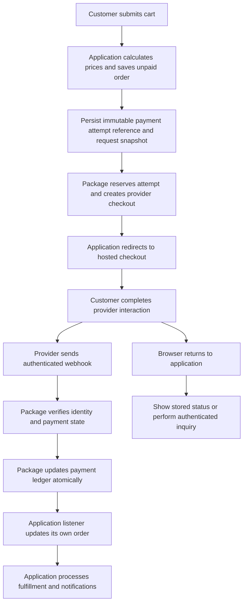
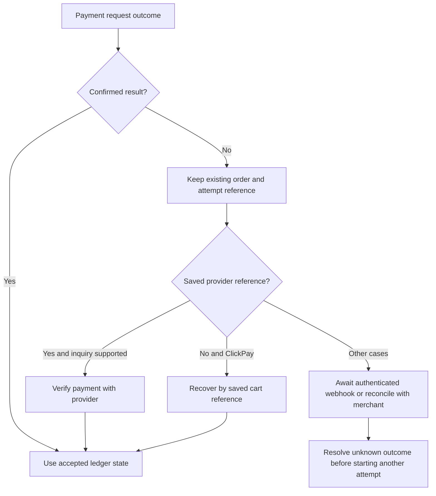

# Integration reference

A standalone Laravel package for **Telr, ClickPay, Tabby, Tamara, MisPay, AlinmaPay and AlRajhi**. It provides direct HTTP integrations, a unified checkout API, authenticated notifications, an optional SQL payment ledger, exact minor-unit amounts and Laravel events.

Detailed integration examples and operational guidance. Start with the [README](../README.md) for installation and gateway selection.

> **Verification status:** local unit/integration tests and HTTP fakes have been exercised on Laravel 12 and 13. Merchant sandbox acceptance, hosted widget rendering and production database concurrency still need deployment-specific verification. Local tests are not provider certification.

## Contents

1. [Responsibilities and payment flow](#1-responsibilities-and-payment-flow)
2. [Supported providers](#2-supported-providers)
3. [Requirements](#3-requirements)
4. [Installation](#4-installation)
5. [Configuration and ENV](#5-configuration-and-env)
6. [Amounts, items and request data](#6-amounts-items-and-request-data)
7. [Quick checkout example](#7-quick-checkout-example)
8. [Complete order-to-checkout example](#8-complete-order-to-checkout-example)
9. [Webhooks and order updates](#9-webhooks-and-order-updates)
10. [Verification, retries and recovery](#10-verification-retries-and-recovery)
11. [Authorization, capture, refunds and cancellation](#11-authorization-capture-refunds-and-cancellation)
12. [Promotional widgets](#12-promotional-widgets)
13. [Events, storage and extensibility](#13-events-storage-and-extensibility)
14. [Testing and troubleshooting](#14-testing-and-troubleshooting)
15. [Operational limits and license](#15-operational-limits-and-license)

## 1. Responsibilities and payment flow

Your application owns products, prices, discounts, tax calculations, orders, inventory, customers, fulfillment and notifications. The package owns provider requests, payment references, authenticated notification handling and its internal payment ledger.

**Creating an order does not mean it is paid. Creating a checkout session does not mean it is paid. A browser success page does not mean it is paid.** Update the order only from a verified payment result or a package event backed by authenticated processing.



The example in section 8 saves the order **before** contacting the provider. This lets a webhook correlate the payment even if it arrives before the checkout HTTP response returns to your application.

## 2. Supported providers

These are implemented package capabilities. `No` means the operation is not implemented here, regardless of other APIs a provider might offer.

| Provider | Hosted checkout | Inquiry | Authenticated webhook | Refund | Capture | Cancel |
| --- | --- | --- | --- | --- | --- | --- |
| Telr | Yes | Yes | Ordered SHA1 advice + inquiry | No | No | No |
| ClickPay | Yes | Yes | Raw-body HMAC + inquiry | No | No | No |
| Tabby | Yes | Yes | Configured shared header + inquiry | Partial/full | Full only | Guarded close |
| Tamara | Yes | Yes | HS256 JWT + inquiry | Partial/full | Full only | Yes |
| MisPay | Yes | No | Shared secret + saved order/track identity | No | No | No |
| AlinmaPay | Yes | Yes, saved payment required | Signed notification/encrypted receipt + mandatory inquiry | Partial/full | Full authorized amount | No |
| AlRajhi | Yes | Yes, saved payment required | Encrypted trandata + mandatory inquiry | No | No | No |

- **Tabby:** customer/provider-driven authorization. The package does not expose a fabricated manual authorization endpoint.
- **Tamara:** display eligibility and manual authorization are available. Manual authorization is refused when `TAMARA_AUTO_AUTHORISATION=true`.
- **MisPay:** the audited integration has no inquiry/refund API. The authenticated notification matches the saved order/track; its amount comes from the saved creation record. Refund notice `MP03` requests reconciliation rather than inventing a refund amount.
- Promotional widgets for Tabby, Tamara and MisPay are supported separately from hosted checkout. They are not embedded payment collection.

Check capabilities before optional operations:

```php
use YacoubAlhaidari\ProviderPayments\Facades\Payment;

$gateway = Payment::gateway('tabby');
$gateway->isEnabled();
$gateway->isConfigured();
$gateway->supports('refund');
$gateway->supports('capture');
$gateway->supports('cancel');
$gateway->capabilities();
```

## 3. Requirements

- PHP **8.3 or newer**, within the Composer constraint `^8.3`, with OpenSSL and Laravel's required extensions.
- Laravel **12 or 13**.
- Guzzle 7, installed through Composer dependencies.
- A configured Laravel application URL using **HTTPS** for checkout return/cancel/webhook URLs.
- A transactional SQL database for the default ledger mode. Configure your application database before running migrations.
- A merchant account and matching API/notification credentials for each enabled provider.

No legacy provider-specific PHP SDK is required at runtime. No provider JavaScript source is bundled.

## 4. Installation

Run consumer commands inside **your Laravel application's directory**, not inside this package directory.

### 4.1 Install from a local checkout

Add a path repository to the Laravel application's existing `composer.json`. Merge this entry with your current configuration; do not replace the entire file:

```json
{
    "repositories": [
        {
            "type": "path",
            "url": "../../packages/provider-payments-sa",
            "options": {
                "symlink": true,
                "versions": {
                    "yacoubalhaidari/provider-payments-sa": "dev-main"
                }
            }
        }
    ]
}
```

Set `url` to the package path relative to your Laravel application directory, or use its absolute path. The example assumes an application two directories below the same workspace root. Forward slashes work on Windows; keep spaces and Arabic characters inside the JSON string.

```sh
composer require yacoubalhaidari/provider-payments-sa:dev-main
```

The explicit path-repository version makes this example work independently of the local branch name. A symlink/junction reflects local package edits immediately; use a reviewed VCS tag or a non-symlink deployment artifact for production.

If the package is available from your own Composer/VCS repository, configure that repository and require its actual reviewed version instead. This guide does not assume a public Packagist release exists.

### 4.2 Publish configuration

Laravel auto-discovers the package service provider and facade binding.

```sh
php artisan payments:install
```

This publishes missing `config/provider-payments.php` and prints setup instructions. It does **not** fill merchant credentials or automatically run database migrations.

Equivalent configuration publication:

```sh
php artisan vendor:publish --tag=provider-payments-config
```

Avoid `--force` unless you intentionally want to replace your application's published configuration.

### 4.3 Prepare environment variables

```sh
php artisan payments:env:sync --dry-run
php artisan payments:env:sync --write
```

`--dry-run` prints missing names and changes nothing. `--write` appends missing safe defaults/placeholders under a file lock; existing values are preserved. Do not combine these flags. The template includes legacy inventory keys as well as active settings; the active settings needed for use are described in section 5.

Supply credentials yourself in your application's secret management/ENV. All gateways default disabled.

### 4.4 Install the payment ledger

```sh
php artisan vendor:publish --tag=provider-payments-migrations
php artisan migrate
```

The package tables are:

- `ppsa_transactions`: immutable attempt identity, provider reference, amount/currency, state and checkout URL.
- `ppsa_webhook_events`: processed/ignored notification receipt identity.
- `ppsa_operations`: reserved/confirmed capture, refund, authorization and cancellation operations.

These tables do not replace your application's `orders` table. Publish migrations once and review later package migration changes before deployment.

### 4.5 Verify local setup

```sh
php artisan payments:list
php artisan payments:diagnose
php artisan route:list --path=payments
php artisan config:cache
```

Diagnostics check local configuration/routes/tables without making payment requests. They do not certify merchant credentials against a live account.

After changing credentials/configuration, rebuild configuration cache and restart any long-lived application workers. For a standard Laravel queue deployment:

```sh
php artisan config:cache
php artisan queue:restart
```

## 5. Configuration and ENV

### 5.1 Global settings

```dotenv
PAYMENTS_ENABLED=true
PAYMENT_PROVIDER=clickpay
PAYMENTS_PERSISTENCE_ENABLED=true
PAYMENTS_ROUTES_ENABLED=true
PAYMENTS_ROUTE_PREFIX=payments
PAYMENTS_TIMEOUT=30
PAYMENTS_QUERY_RETRIES=0
PAYMENTS_LOGGING=false
```

`PAYMENT_PROVIDER` selects the manager's default driver when no gateway is supplied. Request DTO currency is explicit and defaults to `SAR`; a provider `*_CURRENCY` preference does not silently overwrite it.

`PAYMENTS_ENABLED=false` and per-provider enable flags block **new checkout creation**. They do not automatically cancel previous payments or disable authenticated historical inquiry/webhooks/financial operations. Keep credentials available while reconciling existing transactions.

Timeouts are seconds except `TAMARA_PRECHECK_TIMEOUT_MS`, which is milliseconds. GET retries default off and are bounded when enabled. Financial POSTs are never automatically retried.

### 5.2 ClickPay

```dotenv
CLICKPAY_ENABLED=true
CLICKPAY_PROFILE_ID=
CLICKPAY_SERVER_KEY=
CLICKPAY_CURRENCY=SAR
CLICKPAY_CALLBACK_URL=https://your-app.example/payments/clickpay/webhook
```

Use a positive integer merchant profile ID and its paired server key. The configured API host is `https://secure.clickpay.com.sa`; sandbox/live behavior follows your merchant profile. Do not substitute PayTabs credentials. Browser return URL is supplied per attempt in the request DTO.

### 5.3 Telr

```dotenv
TELR_ENABLED=false
TELR_STORE_ID=
TELR_AUTH_KEY=
TELR_SECRET_KEY=
TELR_BASE_URL=https://secure.telr.com
TELR_TEST_MODE=true
TELR_TIMEOUT=30
TELR_CURRENCY=SAR
TELR_RETURN_AUTHORISED=https://your-app.example/checkout/return
TELR_RETURN_DECLINED=https://your-app.example/checkout/return
TELR_RETURN_CANCELLED=https://your-app.example/checkout/return
```

Store/auth key authenticate hosted checkout and inquiry. Secret key verifies transaction advice. Register the package webhook URL in the merchant dashboard. The same API host uses the test flag; switch to live only after validating the merchant account. Attempt reference is limited to 63 bytes.

The static return URLs above are optional fallback examples. In an order integration, pass actual per-order return URLs explicitly as in section 8.

### 5.4 Tabby

```dotenv
TABBY_ENABLED=false
TABBY_BASE_URL=https://api.tabby.ai
TABBY_MERCHANT_CODE=
TABBY_SECRET_KEY=
TABBY_PUBLIC_KEY=
TABBY_CURRENCY=SAR
TABBY_WEBHOOK_HEADER_TITLE=X-Tabby-Secret
TABBY_WEBHOOK_HEADER_VALUE=
TABBY_WEBHOOK_URL=https://your-app.example/payments/tabby/webhook
TABBY_SUCCESS_URL=
TABBY_CANCEL_URL=
TABBY_FAILURE_URL=
```

Use the merchant-approved regional endpoint, such as `api.tabby.ai` or `api.tabby.sa`. Server API calls use the **secret** key; the public key is for promotional widgets. Register the exact webhook header title/value with Tabby. Test keys beginning `sk_test_` require an approved test email; production buyers use name/phone and may omit email. Supply real buyer/order history through metadata when required by your account.

### 5.5 Tamara

```dotenv
TAMARA_ENABLED=false
TAMARA_BASE_URL=https://api-sandbox.tamara.co
TAMARA_API_TOKEN=
TAMARA_NOTIFICATION_TOKEN=
TAMARA_PUBLIC_KEY=
TAMARA_AUTO_AUTHORISATION=true
TAMARA_WEBHOOK_URL=https://your-app.example/payments/tamara/webhook
TAMARA_SUCCESS_URL=
TAMARA_CANCEL_URL=
TAMARA_FAILURE_URL=
TAMARA_PRECHECK_ENABLED=true
TAMARA_PRECHECK_TIMEOUT_MS=200
TAMARA_PRECHECK_CACHE_SECONDS=60
TAMARA_PRECHECK_FAILURE_COOLDOWN_SECONDS=10
```

Production base URL is `https://api.tamara.co`. Pair API and notification tokens with the selected account/environment. API token authenticates server requests; notification token verifies HS256 notifications. Eligibility failures may keep the payment option visible, but never establish payment success. Automatic authorization is not automatic capture.

### 5.6 MisPay

```dotenv
MISPAY_ENABLED=false
MISPAY_BASE_URL=https://api-sandbox.mispay.dev/v1/api
MISPAY_APP_ID=
MISPAY_APP_SECRET=
MISPAY_WEBHOOK_SECRET=
MISPAY_WHITELIST_IP=
MISPAY_WEBHOOK_URL=https://your-app.example/payments/mispay/webhook
MISPAY_SUCCESS_URL=
MISPAY_CANCEL_URL=
MISPAY_FAILURE_URL=
MISPAY_SEND_CALLBACK_OVERRIDE=false
MISPAY_WIDGET_KEY=
MISPAY_WIDGET_URL=https://widget-sandbox.mispay.dev/v1/sdk.js
```

The audited checkout uses SAR and v1.2 payloads. Obtain the production API base directly from your merchant provider; do not guess it from widget hostnames. Configure a shared webhook secret with the provider, or set MISPAY_WHITELIST_IP to the exact public source IP addresses confirmed for your merchant integration. The allowlist is optional, defaults empty, and accepts comma/space/semicolon-separated public addresses. With an allowlist, an exact matching request IP authenticates notifications without a shared header. Unlisted requests still require a valid shared secret. Laravel trusted-proxy settings must reflect your actual infrastructure; never trust client-supplied forwarding headers from arbitrary peers. Saved order and checkout identity validation still applies after authentication. If the secret variable is entirely unset, config can fall back to the app secret; an explicitly blank variable does not provide a valid secret.

Keep callback override false unless the merchant profile confirms `callbackUrl` support. Optional widget production script is `https://widget.mispay.co/v1/sdk.js`; its widget key is a public browser credential, unlike the server app secret.

### 5.7 AlinmaPay

```dotenv
ALINMAPAY_ENABLED=false
ALINMAPAY_ENV=sandbox
ALINMAPAY_TERMINAL_ID=
ALINMAPAY_TERMINAL_PASSWORD=
ALINMAPAY_MERCHANT_KEY=
ALINMAPAY_PAYMENT_TYPE=1
ALINMAPAY_RECEIPT_URL=
ALINMAPAY_CANCEL_URL=
ALINMAPAY_FAILURE_URL=
```

The gateway slug is **`alinmapay`**. Existing `ALINMAPAY_ENV`, terminal ID/password and merchant key names are retained. Sandbox uses `https://pg.alinmapay.com.sa/SB_Transactions/v2/payments/pay-request`; production uses `/Transactions/v2/payments/pay-request` on the same host. Set `ALINMAPAY_ENV=production` only for a live merchant account. The merchant key must be a 32- or 64-character hexadecimal string; request signatures use its original text. Receipt decryption follows the source AES-128-ECB protocol using the first 16 decoded key bytes.

Checkout types are `1` purchase, `4` preauthorization and `15` payment link. Keep the intended mode stable during checkout. Preauthorization is confirmed by bank inquiry, then captured separately; it is not an instruction to fulfill an order. The source's HTTP timeout for outbound webhook delivery is not a checkout API timeout: use `PAYMENTS_TIMEOUT` for this package's bank requests.

Only SAR is supported by this integration. The DTO's `successUrl` becomes `receiptUrl` inside `additionalDetails.userData`. The source protocol has one receipt callback rather than three independently registered browser outcomes; `cancelUrl` remains part of the unified DTO contract but is not sent as an invented AlinmaPay field. The separate package notification endpoint is `POST /payments/alinmapay/webhook`, to be configured with the merchant account if notifications are available.

Plain notifications require the exact `X-AlinmaPay-Signature` header or a body `signature`, calculated by the source response formula `SHA256(transactionId|merchantKey|responseCode|amount)`. AES/base64 receipts arrive in `data`. Both forms must match a saved order/transaction, amount and currency, then pass a fresh bank inquiry. A signature does not authenticate the notification's arbitrary event/result fields; those fields never settle an order directly.

Inquiry requires `transactionId`, original `orderId`, amount and currency. A generic `SUCCESS`/`000` must also identify `paymentType` (`4` is authorized; `1`, `5` and `15` are paid); explicit financial statuses such as `AUTHORIZED` or `CAPTURED` are also recognized. A response lacking enough information to distinguish authorization from payment is rejected for reconciliation, rather than guessed from the application's current checkout mode. Verify the exact inquiry response supplied by your merchant environment before going live.

### 5.8 AlRajhi

```dotenv
ALRAJHI_ENABLED=false
ALRAJHI_ENVIRONMENT=sandbox
ALRAJHI_BASE_URL=https://securepayments.alrajhibank.com.sa
ALRAJHI_TRANPORTAL_ID=
ALRAJHI_TRANPORTAL_PASSWORD=
ALRAJHI_RESOURCE_KEY=
ALRAJHI_MERCHANT_IP=
ALRAJHI_ACTION=1
ALRAJHI_TRANDATA_FORMAT=array
ALRAJHI_URL_ENCODE_BEFORE_ENCRYPT=false
ALRAJHI_URL_DECODE_AFTER_DECRYPT=false
ALRAJHI_RESPONSE_URL=
ALRAJHI_ERROR_URL=
```

The slug is **`alrajhi`**. Existing terminal/resource-key and callback names are retained. Configure a valid `ALRAJHI_MERCHANT_IP` for background inquiries/operations. A saved `CustomerDTO::ip` overrides it during checkout; resolve customer IP through Laravel's trusted-proxy configuration, not an arbitrary untrusted forwarded header.

The resource key is **exactly 32 literal bytes**. Do not hex-decode it merely because it looks hexadecimal. The protocol uses AES-256-CBC, IV `PGKEYENCDECIVSPC`, uppercase hexadecimal ciphertext and JSON-array request envelopes. `ALRAJHI_TRANDATA_FORMAT=object` selects a merchant-approved object inside the encrypted envelope; the outer envelope remains an array. Set URL encode/decode flags to the format approved for your terminal. The package makes one request per operation and does not automatically retry alternative encryption formats after an error.

Only SAR (`currencyCode=682`) is supported. `ALRAJHI_ACTION=1` starts a sale; `4` starts a hosted authorization. Initiation wrapper `status=1` indicates checkout creation, not payment. Inquiry uses action `8`, `udf5=PaymentID` and the saved hosted `PaymentID`. The bank `transId` is a different identifier; do not substitute it for the hosted payment ID. `APPROVED` maps conservatively to `authorized`; fulfillment requires an explicit captured/paid state.

For production set both `ALRAJHI_ENVIRONMENT=production` and `ALRAJHI_BASE_URL=https://digitalpayments.neoleap.com.sa` when this is the merchant-approved endpoint. An explicit `ALRAJHI_BASE_URL` overrides environment selection; do not leave the sandbox URL in ENV when switching environments. These two exact HTTPS hosts are allowed.

`successUrl` maps to `responseURL`; `failureUrl` (or `cancelUrl`) maps to `errorURL`. There is no invented separate webhook parameter in the bank-hosted request. The package supports encrypted `trandata` at `POST /payments/alrajhi/webhook`; it requires original track, hosted payment ID, amount and currency and performs a bank inquiry before applying any transition. Plain unsigned callback fields are rejected. CBC encryption is not a MAC and never serves as sole settlement evidence.

### Existing application upgrade

Update the package using the same Composer source/version policy as your installation. No legacy AlinmaPay/AlRajhi SDK dependency is added, and existing gateway defaults and DTO signatures remain unchanged. The provider automatically adds missing provider entries from package defaults when loading an older published configuration; existing entries and consumer overrides are preserved. A configuration cache must be rebuilt to include new settings.

```bash
php artisan payments:env:sync --dry-run
php artisan payments:env:sync --write
php artisan config:clear
php artisan route:clear
php artisan payments:list
php artisan payments:diagnose
php artisan config:cache
php artisan route:cache
php artisan queue:restart
```

Fill merchant credentials and enable only the intended new bank before caching configuration. If your application customizes bank configuration, merge its new provider entries into the published `config/provider-payments.php`; avoid overwriting the complete file with `vendor:publish --force`. Existing payment tables are reused; this addition requires no schema migration. The commands above belong to the consuming application; they were not executed against your existing business projects.

### 5.9 Request defaults and routes

Explicit `successUrl`, `cancelUrl`, `failureUrl` and `webhookUrl` win over provider URL defaults. Blank defaults are ignored. Supply HTTPS success/cancel URLs before creation; use real routes in your consumer app, not the illustrative URLs above.

To customize routing, set the published configuration's `routes` value to this array (shown here as a PHP variable):

```php
$routes = [
    'enabled' => true,
    'prefix' => 'integrations/payments',
    'middleware' => [],
];
```

Then update merchant webhook URLs accordingly and rebuild config/route caches. Do not attach customer login or web/CSRF middleware to provider webhook routes. Use appropriate ingress/rate-limit policy for provider traffic.

## 6. Amounts, items and request data

All DTO money is integer **minor units**:

```php
use YacoubAlhaidari\ProviderPayments\Support\Money;

Money::minor('150.00', 'SAR');   // 15000
Money::decimal(15000, 'SAR');   // "150.00"
Money::minor('1.234', 'BHD');    // 1234
```

Supported currency enum values: SAR, AED, KWD, BHD, OMR, QAR, USD and EUR. Currency support in this enum does not mean every merchant/provider supports that currency. Excess precision and overflow are rejected. Do not pass floats such as `150.00` or calculate charges from untrusted browser amounts.

For BNPL checkout:

```text
sum(unitPrice * quantity) + shippingAmount + taxAmount - discountAmount = amount
```

Use positive integer quantities and final inclusive unit prices; per-item tax/discount fields must be zero in the normalized checkout flow. Apply separate order-level adjustments once. Do not add VAT a second time if it is already included in the unit price. Normalize weighted/fractional items and wallet allocations in your application before constructing DTOs.

Example: two items at SAR 75.00, shipping SAR 10.00, no additional tax/discount:

```php
new OrderItemDTO(name: 'Item', unitPrice: 7500, quantity: 2, sku: 'SKU-1');
// Item total 15000 + shipping 1000 = amount 16000 (SAR 160.00).
```

CustomerDTO accepts name, email, phone, street, city, country, zip and optional ip. BNPL requires real contact/shipping data. Do not replace a real customer's identity with sandbox test data automatically. Optional `metadata['buyer_history']` and `metadata['order_history']` for Tabby must contain factual account/order history; arbitrary metadata is not automatically persisted or echoed into every provider request.

## 7. Quick checkout example

This example demonstrates the package API. For an actual order, persist the attempt and request data first as shown in section 8.

```php
use YacoubAlhaidari\ProviderPayments\DTOs\CustomerDTO;
use YacoubAlhaidari\ProviderPayments\DTOs\OrderItemDTO;
use YacoubAlhaidari\ProviderPayments\DTOs\PaymentRequestDTO;
use YacoubAlhaidari\ProviderPayments\Facades\Payment;

$result = Payment::gateway('clickpay')->createPayment(new PaymentRequestDTO(
    orderReference: 'PAY-immutable-attempt-1001',
    amount: 16000,
    currency: 'SAR',
    customer: new CustomerDTO(
        name: 'Customer Name',
        email: 'customer@example.com',
        phone: '+966500000000',
        street: 'Customer street',
        city: 'Riyadh',
        country: 'SA',
        zip: '12345',
    ),
    successUrl: 'https://your-app.example/checkout/return',
    cancelUrl: 'https://your-app.example/checkout/return',
    failureUrl: 'https://your-app.example/checkout/return',
    webhookUrl: 'https://your-app.example/payments/clickpay/webhook',
    description: 'Order #1001',
    items: [new OrderItemDTO('Item', 7500, 2, sku: 'SKU-1')],
    shippingAmount: 1000,
));

if ($result->requiresRedirect()) {
    return redirect()->away($result->checkoutUrl);
}
```

To use another enabled provider, change the gateway slug and matching webhook URL, retaining the required provider customer/items/account settings. MisPay cannot be verified with `getPaymentStatus`; its confirmation comes from authenticated notifications.

PaymentResponseDTO exposes provider, status, providerTransactionId, orderReference, amount, currency, checkoutUrl, sessionId, providerStatus, message, raw and metadata. `isSuccessful()` is true only for `paid`/`captured`; `authorized` is not paid. Most successful create calls return `requires_action`, not a successful payment.


### Bank checkout example

Use the same normalized request for either new bank. Save `orderReference`, amount, customer and URLs as an immutable attempt before sending:

```php
use YacoubAlhaidari\ProviderPayments\DTOs\CustomerDTO;
use YacoubAlhaidari\ProviderPayments\DTOs\PaymentRequestDTO;
use YacoubAlhaidari\ProviderPayments\Facades\Payment;

$request = new PaymentRequestDTO(
    orderReference: 'ORDER-1042-ATTEMPT-1',
    amount: 16000,
    currency: 'SAR',
    customer: new CustomerDTO(
        name: 'Example Customer', email: 'customer@example.com',
        phone: '+966500000000', street: 'Example Street', city: 'Riyadh',
        country: 'SA', zip: '12345', ip: '192.0.2.25',
    ),
    successUrl: 'https://your-app.example/orders/1042/payment-return',
    cancelUrl: 'https://your-app.example/orders/1042/payment-return',
    failureUrl: 'https://your-app.example/orders/1042/payment-return',
    description: 'Order 1042',
);

$result = Payment::gateway('alinmapay')->createPayment($request);
// To choose AlRajhi for this order, call gateway('alrajhi') instead.
// Do not call both gateways for the same purchase.
if ($result->requiresRedirect()) {
    return redirect()->away($result->checkoutUrl);
}
```

Use actual public routes and the customer's saved IP; the example IP is documentation-only. Save the selected gateway with the attempt. On return call `Payment::verifyPayment($savedProviderReference, $savedGateway)` as in section 8. The browser POST bridge in that example deliberately ignores callback fields and subsequently verifies the saved identity on authenticated GET. Neither bank automatically receives the DTO's `webhookUrl`: configure notifications with the bank where supported, and use inquiry/reconciliation when the browser never returns.

For both banks, persistence must remain enabled for inquiry, notifications and money operations. No cart-reference recovery is exposed for an ambiguous initial bank creation; keep the reservation and reconcile through the merchant channel before another attempt. Both adapters implement hosted checkout and inquiry through the unified API. AlinmaPay additionally implements refunds and full authorized capture. AlRajhi does not advertise refund, capture or cancellation: its supplied source implements inquiry but describes those operations as coming soon. Direct card collection, independent Apple Pay merchant validation, iframe/tokenized faster checkout, standalone refunds and subscriptions are not ported as public capabilities.

## 8. Complete order-to-checkout example

The following code belongs to the **consuming Laravel application**, not to this package. Adapt it to your existing models. It assumes authenticated web users and a `Product` model containing `id`, `name`, `sku`, `price_minor` and `is_active`. Product prices are integer SAR minor units. Inventory reservation, delivery availability and tax policy remain application responsibilities.

### A. Store an immutable order snapshot

Add these columns to your application's orders migration, or map them to equivalent existing fields:

```php
use Illuminate\Database\Schema\Blueprint;
use Illuminate\Support\Facades\Schema;

Schema::create('orders', function (Blueprint $table) {
    $table->id();
    $table->foreignId('user_id')->constrained();
    $table->uuid('checkout_key')->unique();
    $table->string('request_hash', 64);
    $table->string('gateway', 16);
    $table->char('currency', 3);
    $table->unsignedBigInteger('amount_minor');
    $table->unsignedBigInteger('shipping_minor')->default(0);
    $table->unsignedBigInteger('tax_minor')->default(0);
    $table->unsignedBigInteger('discount_minor')->default(0);
    $table->string('payment_attempt_reference', 63)->unique();
    $table->string('provider_reference')->nullable();
    $table->text('checkout_url')->nullable();
    $table->json('items_snapshot');
    $table->text('customer_snapshot');
    $table->string('payment_status')->default('pending');
    $table->string('status')->default('awaiting_payment');
    $table->timestamp('paid_at')->nullable();
    $table->timestamps();
});

Schema::create('order_outbox', function (Blueprint $table) {
    $table->id();
    $table->string('dedupe_key')->unique();
    $table->string('topic');
    $table->json('payload');
    $table->timestamp('published_at')->nullable();
    $table->timestamps();
});
```

Example `App\Models\Order` model:

```php
namespace App\Models;

use Illuminate\Database\Eloquent\Model;

class Order extends Model
{
    // Assign only the explicit server-built arrays shown below.
    protected $guarded = [];

    protected function casts(): array
    {
        return [
            'items_snapshot' => 'array',
            'customer_snapshot' => 'encrypted:array',
            'amount_minor' => 'integer',
            'shipping_minor' => 'integer',
            'tax_minor' => 'integer',
            'discount_minor' => 'integer',
            'paid_at' => 'datetime',
        ];
    }
}
```

Encryption uses the consuming application's `APP_KEY`; retain that key securely. Treat checkout URLs as sensitive bearer links. Do not serialize the full model into public APIs.

### B. Create the order using server-side prices

Example `App\Http\Controllers\OrderController`. The browser generates one `checkout_key` UUID for a cart submission and reuses it if that submission is retried. A different payload with the same key returns a conflict. Production applications should also enforce stock and customer purchase limits here.

```php
namespace App\Http\Controllers;

use App\Models\Order;
use App\Models\Product;
use Illuminate\Http\Request;
use Illuminate\Support\Facades\DB;
use Illuminate\Support\Str;
use Illuminate\Validation\Rule;

class OrderController extends Controller
{
    public function store(Request $request)
    {
        $data = $request->validate([
            'checkout_key' => ['required', 'uuid'],
            'gateway' => ['required', Rule::in(['telr', 'clickpay', 'tabby', 'tamara', 'mispay', 'alinmapay', 'alrajhi'])],
            'items' => ['required', 'array', 'min:1', 'max:50'],
            'items.*.product_id' => ['required', 'integer', 'distinct'],
            'items.*.quantity' => ['required', 'integer', 'min:1', 'max:100'],
            'customer.name' => ['required', 'string', 'max:150'],
            'customer.email' => ['required', 'email', 'max:254'],
            'customer.phone' => ['required', 'string', 'max:30'],
            'customer.street' => ['required', 'string', 'max:200'],
            'customer.city' => ['required', 'string', 'max:100'],
            'customer.country' => ['required', Rule::in(['SA'])],
            'customer.zip' => ['required', 'string', 'max:20'],
        ]);

        abort_unless(config('provider-payments.enabled'), 503, 'Payments are unavailable.');
        abort_unless(config("provider-payments.providers.{$data['gateway']}.enabled"), 422, 'Gateway unavailable.');
        $hash = hash('sha256', json_encode($data, JSON_THROW_ON_ERROR));

        $order = DB::transaction(function () use ($data, $hash, $request) {
            $existing = Order::where('checkout_key', $data['checkout_key'])->first();
            if ($existing) {
                abort_unless((int) $existing->user_id === (int) $request->user()->id
                    && hash_equals($existing->request_hash, $hash), 409, 'Checkout key already used.');
                return $existing;
            }

            $items = [];
            $subtotal = 0;
            foreach ($data['items'] as $line) {
                $product = Product::whereKey($line['product_id'])->where('is_active', true)->firstOrFail();
                $price = (int) $product->price_minor;
                abort_unless($price > 0 && $price <= 100000000, 422, 'Invalid product price.');
                $quantity = (int) $line['quantity'];
                $items[] = [
                    'name' => $product->name,
                    'sku' => (string) $product->sku,
                    'unit_price' => $price,
                    'quantity' => $quantity,
                ];
                $subtotal += $price * $quantity;
            }

            // Example delivery policy: SAR 10; replace with your server-side rules.
            $shipping = 1000;
            $order = Order::firstOrCreate(['checkout_key' => $data['checkout_key']], [
                'user_id' => $request->user()->id,
                'request_hash' => $hash,
                'gateway' => $data['gateway'],
                'currency' => 'SAR',
                'amount_minor' => $subtotal + $shipping,
                'shipping_minor' => $shipping,
                'tax_minor' => 0,
                'discount_minor' => 0,
                'payment_attempt_reference' => (string) Str::uuid(),
                'items_snapshot' => $items,
                'customer_snapshot' => $data['customer'],
            ]);
            // Also check the row returned after a concurrent unique-key conflict.
            abort_unless((int) $order->user_id === (int) $request->user()->id
                && hash_equals($order->request_hash, $hash), 409, 'Checkout key already used.');
            return $order;
        });

        return response()->json([
            'order_id' => $order->id,
            'status' => $order->status,
            'checkout_endpoint' => route('checkout.start', $order),
        ], 201);
    }
}
```

Check the published configuration structure before adapting gateway validation. Never accept `amount_minor`, prices, payment status or a payment reference from the browser. The unique checkout key prevents a network retry from creating a second order; use a new key for a genuinely new cart submission.

### C. Start checkout from the saved order

Example `App\Http\Controllers\CheckoutController`. Keep the public application origin stable while an attempt is pending: changing callback URLs, descriptions or metadata changes the request fingerprint.

```php
namespace App\Http\Controllers;

use App\Models\Order;
use Illuminate\Http\Request;
use YacoubAlhaidari\ProviderPayments\DTOs\CustomerDTO;
use YacoubAlhaidari\ProviderPayments\DTOs\OrderItemDTO;
use YacoubAlhaidari\ProviderPayments\DTOs\PaymentRequestDTO;
use YacoubAlhaidari\ProviderPayments\Exceptions\PaymentException;
use YacoubAlhaidari\ProviderPayments\Facades\Payment;
use YacoubAlhaidari\ProviderPayments\Repositories\PaymentLedger;

class CheckoutController extends Controller
{
    public function start(Request $request, Order $order)
    {
        abort_unless((int) $order->user_id === (int) $request->user()->id, 403);
        if ($order->paid_at) {
            return redirect()->route('checkout.return', $order);
        }

        $returnUrl = route('checkout.return', $order);
        $payment = new PaymentRequestDTO(
            orderReference: $order->payment_attempt_reference,
            amount: $order->amount_minor,
            currency: $order->currency,
            customer: CustomerDTO::fromArray($order->customer_snapshot),
            successUrl: $returnUrl,
            cancelUrl: $returnUrl,
            failureUrl: $returnUrl,
            webhookUrl: route('provider-payments.webhook', ['provider' => $order->gateway]),
            description: 'Order '.$order->id,
            items: array_map(fn (array $line) => new OrderItemDTO(
                name: $line['name'],
                unitPrice: $line['unit_price'],
                quantity: $line['quantity'],
                sku: $line['sku'],
            ), $order->items_snapshot),
            metadata: ['order_id' => (string) $order->id],
            language: 'ar',
            shippingAmount: $order->shipping_minor,
            taxAmount: $order->tax_minor,
            discountAmount: $order->discount_minor,
        );

        try {
            // Provider HTTP runs outside the application's order transaction.
            $result = Payment::gateway($order->gateway)->createPayment($payment);
        } catch (PaymentException $exception) {
            // Log a sanitized error internally; do not expose provider response bodies.
            return response()->json([
                'order_id' => $order->id,
                'message' => 'Checkout could not be confirmed. Check this order before retrying.',
            ], 409);
        }

        // A webhook may already have marked the order paid. Do not overwrite its status.
        Order::whereKey($order->id)->update([
            'provider_reference' => $result->providerTransactionId,
            'checkout_url' => $result->checkoutUrl,
        ]);

        if ($result->requiresRedirect()) {
            return redirect()->away($result->checkoutUrl);
        }
        return redirect()->route('checkout.return', $order);
    }

    public function returned(Request $request, Order $order)
    {
        abort_unless((int) $order->user_id === (int) $request->user()->id, 403);
        // Read saved identity, never payment_id/status/amount supplied by the browser.
        try {
            $ledger = app(PaymentLedger::class)->find(
                $order->gateway, null, $order->payment_attempt_reference,
            );
            if ($ledger->provider_reference
                && Payment::gateway($order->gateway)->supports('verify')) {
                Payment::verifyPayment($ledger->provider_reference, $order->gateway);
            }
        } catch (PaymentException $exception) {
            // No attempt yet, or inquiry unavailable: keep the saved order state.
        }
        $order->refresh();
        return response()->json([
            'order_id' => $order->id,
            'order_status' => $order->status,
            'payment_status' => $order->payment_status,
            'paid' => $order->paid_at !== null,
        ])->header('Cache-Control', 'no-store');
    }
}
```

The return handler displays JSON to keep the example complete; replace it with your order-status Blade view. A pending response should show “Checking payment” with a rate-limited status refresh. MisPay waits for its authenticated notification. Do not label a timeout as a failed charge or allocate a fresh attempt automatically.

### D. Add application routes

In the application's `routes/web.php`:

```php
use App\Http\Controllers\CheckoutController;
use App\Http\Controllers\OrderController;
use Illuminate\Http\Request;
use Illuminate\Support\Facades\Route;

Route::middleware(['auth', 'throttle:30,1'])->group(function () {
    Route::post('/orders', [OrderController::class, 'store'])->name('orders.store');
    Route::post('/orders/{order}/checkout', [CheckoutController::class, 'start'])
        ->name('checkout.start');
    Route::get('/orders/{order}/payment-return', [CheckoutController::class, 'returned'])
        ->name('checkout.return');
});

// Some providers return the browser using POST. This bridge performs no payment action.
Route::post('/orders/{order}/payment-return', function (Request $request, string $order) {
    return redirect()->route('checkout.return', ['order' => $order], 303);
})->whereNumber('order')->withoutMiddleware([
    \Illuminate\Foundation\Http\Middleware\ValidateCsrfToken::class,
    \Illuminate\Foundation\Http\Middleware\PreventRequestForgery::class,
    \Illuminate\Session\Middleware\StartSession::class,
    \Illuminate\View\Middleware\ShareErrorsFromSession::class,
])->middleware('throttle:20,1');
```

The two CSRF class names cover Laravel 12/13 defaults. If your application adds custom CSRF/session middleware, adjust the bridge accordingly. It discards provider POST data and redirects only to the fixed internal GET route, where login and ownership checks apply. It avoids starting a new session on a cross-site POST without the existing SameSite cookie. A logged-out customer may need to log in again; webhook processing remains independent of the browser session.

For an authenticated Blade page, create the order with `POST /orders` using CSRF protection, then submit a CSRF-protected form to the returned `checkout_endpoint`. For a product priced at SAR 75, quantity 2, the example saves SAR 150 merchandise + SAR 10 shipping = **16000 minor units**, then redirects to the provider. A SPA/mobile client should return the checkout URL from its authenticated API and open it using its own navigation/authentication flow; adapt the controller response accordingly.

## 9. Webhooks and order updates

Use the package route, normally `POST /payments/{provider}/webhook`. Confirm your actual prefix using `php artisan route:list --name=provider-payments`. Register the public HTTPS URL with each merchant account as required. These server-to-server endpoints must not require customer login or browser CSRF tokens. Keep provider authentication enabled.

The package verifies each provider's notification and correlates it with the saved payment. ClickPay, Telr, Tabby and Tamara use authenticated inquiry where required; MisPay uses its configured shared secret and saved order/track identity. Never implement an alternative “mark paid” endpoint that accepts a browser status.

### Update your order once and schedule fulfillment safely

Example `App\Payments\ApplyPaymentStatus`:

```php
namespace App\Payments;

use App\Models\Order;
use Illuminate\Support\Facades\DB;
use YacoubAlhaidari\ProviderPayments\Events\PaymentStatusChanged;
use YacoubAlhaidari\ProviderPayments\Repositories\PaymentLedger;

class ApplyPaymentStatus
{
    public function handle(PaymentStatusChanged $event): void
    {
        DB::transaction(function () use ($event) {
            $payment = app(PaymentLedger::class)->find(
                $event->provider, $event->transactionReference,
            );
            if (! $payment) {
                throw new \RuntimeException('Payment ledger record missing.');
            }
            $order = Order::where('gateway', $event->provider)
                ->where('payment_attempt_reference', $payment->order_reference)
                ->lockForUpdate()->firstOrFail();

            if ((int) $payment->amount !== $order->amount_minor
                || $payment->currency !== $order->currency) {
                throw new \RuntimeException('Order/payment amount mismatch.');
            }
            $order->provider_reference = $event->transactionReference;
            $order->payment_status = $event->status->value;
            if ($event->status->isSuccessful() && ! $order->paid_at) {
                $order->paid_at = now();
                $order->status = 'processing';
                DB::table('order_outbox')->insertOrIgnore([
                    'dedupe_key' => 'order-paid:'.$order->id,
                    'topic' => 'order.paid',
                    'payload' => json_encode(['order_id' => $order->id], JSON_THROW_ON_ERROR),
                    'created_at' => now(),
                    'updated_at' => now(),
                ]);
            }
            $order->save();
        });
    }
}
```

Register this listener **once**, for example in the consuming application's `AppServiceProvider::boot()`:

```php
\Illuminate\Support\Facades\Event::listen(
    \YacoubAlhaidari\ProviderPayments\Events\PaymentStatusChanged::class,
    \App\Payments\ApplyPaymentStatus::class,
);
```

Keep this projection synchronous and use the same database connection for package ledger, orders and outbox so a listener failure rolls back the payment transition and receipt together. Correlation uses the saved attempt reference, so a webhook arriving before `start()` saves the provider reference still finds the order. An `authorized` payment does not trigger fulfillment.

Add an application worker that reads unpublished `order_outbox` rows, performs fulfillment/email actions with `dedupe_key` as an idempotency key, then marks `published_at`. The example creates the durable handoff; it does not supply your shipping/email implementation. External effects require their own idempotency because a worker can crash after sending but before acknowledging. Decide explicit business policies for cancellation, expiry, partial refunds and refunds; do not erase historical `paid_at` or silently reverse shipped inventory.

Duplicate or stale notifications return accepted HTTP responses without repeating a financial transition. Invalid authentication, mismatched identity/currency/amount and unknown local references are rejected. If processing fails, keep the saved order pending and investigate/retry through the provider's supported delivery mechanism.

## 10. Verification, retries and recovery

Use **saved server-side references**, not values received from browser return parameters:

```php
use YacoubAlhaidari\ProviderPayments\Facades\Payment;

// Remote inquiry only: does not apply a transition to the package ledger.
$remote = Payment::getPaymentStatus($savedProviderReference, 'clickpay');

// Preferred for an existing local payment: query, validate and reconcile its ledger.
$accepted = Payment::verifyPayment($savedProviderReference, 'clickpay');

// ClickPay only: recover an ambiguous creation using its saved cart/order reference.
$recovered = Payment::recoverPayment($savedAttemptReference, 'clickpay');
```

`verifyPayment()` returns the **accepted local state**. When the remote state conflicts with a protected local transition, inspect `metadata['reconciliation_required']` and `metadata['remote_status']`; do not fulfill from the rejected remote observation. Recovery validates a unique matching cart, amount and currency and attaches the discovered provider reference. It does not create another sale or guarantee a replacement checkout URL.

### What to retry

- Save one attempt reference and the complete immutable request before making a creation request. The same gateway/reference/request can return the saved result. Changing items, customer data, URLs, language or metadata for the same reference is rejected.
- If creation times out, the provider may already have created a checkout. The ledger retains the reservation; repeating `createPayment()` is not an instruction to issue a second remote creation. Use supported recovery/inquiry, provider dashboard reconciliation or merchant support.
- If an inquiry fails, retain the last accepted state and retry inquiry with bounded backoff. MisPay has no inquiry in this package; use its authenticated notification and merchant reconciliation.
- If capture/refund/cancellation has an unknown outcome, keep its stable operation reference and investigate before another operation. Do not change the reference to bypass a reservation.
- Create a new attempt only after the previous attempt is confirmed safe to abandon. In an application allowing several attempts per order, store them in a separate attempts table and correlate every webhook with its original attempt. The single-attempt example above intentionally does not overwrite historical references.



## 11. Authorization, capture, refunds and cancellation

These are merchant/backend operations. Protect them with staff permissions, business rules and audit logging. Resolve the provider reference and amount from your own saved payment. Check capabilities before calling optional interfaces; an available provider API does not imply package support.

### Partial or full refund: Tabby and Tamara

```php
use YacoubAlhaidari\ProviderPayments\DTOs\RefundRequestDTO;
use YacoubAlhaidari\ProviderPayments\Facades\Payment;

$gateway = Payment::gateway('tabby');
if (! $gateway->supports('refund')) {
    throw new \RuntimeException('Refund unavailable.');
}
$result = $gateway->refund(new RefundRequestDTO(
    transactionReference: $savedProviderReference,
    amount: 5000, // SAR 50.00, within the confirmed remaining refundable balance.
    currency: 'SAR',
    reason: 'Customer returned one item',
    refundReference: 'return-1042-refund-1', // Persist before sending; reuse for this operation.
));
```

Use `tamara` for Tamara. A full refund uses the remaining confirmed refundable amount. The ledger refuses refunds exceeding that balance or when an amount-less provider notice makes the balance unknown. A successful transport response alone is not permission to issue the refund again.

### Full capture: Tabby

Capture requires an existing locally `authorized` payment and the full authorized amount. For the SAR 160 order used above:

```php
use YacoubAlhaidari\ProviderPayments\DTOs\CaptureRequestDTO;
use YacoubAlhaidari\ProviderPayments\Facades\Payment;

$result = Payment::gateway('tabby')->capture(new CaptureRequestDTO(
    transactionReference: $savedProviderReference,
    amount: 16000,
    currency: 'SAR',
    metadata: [
        'reference_id' => 'shipment-1042-capture-1',
        'items' => [[
            'reference_id' => 'sku-75',
            'title' => 'Example product',
            'quantity' => 2,
            'unit_price' => '75.00',
            'discount_amount' => '0.00',
        ]],
    ],
    shippingAmount: 1000,
));
```

Unlike the normalized checkout DTO, provider-specific capture metadata contains **major-unit decimal strings**. Do not put `7500` into an API field expecting `'75.00'`. Tabby capture normalizes optional item fields and validates the returned matching capture; an unconfirmed capture remains reserved for reconciliation.

### Full capture: Tamara

Tamara additionally requires provider-shaped items and shipping information. Persist the shipment data and operation reference before sending; replace the sample identifiers/date with actual saved shipment data:

```php
use YacoubAlhaidari\ProviderPayments\DTOs\CaptureRequestDTO;
use YacoubAlhaidari\ProviderPayments\Facades\Payment;

$money = fn (string $amount) => ['amount' => $amount, 'currency' => 'SAR'];
$result = Payment::gateway('tamara')->capture(new CaptureRequestDTO(
    transactionReference: $savedProviderReference,
    amount: 16000,
    currency: 'SAR',
    metadata: [
        'reference_id' => 'shipment-1042-capture-1',
        'items' => [[
            'reference_id' => 'sku-75', 'sku' => 'sku-75',
            'name' => 'Example product', 'type' => 'Physical', 'quantity' => 2,
            'unit_price' => $money('75.00'),
            'total_amount' => $money('150.00'),
            'tax_amount' => $money('0.00'),
            'discount_amount' => $money('0.00'),
        ]],
        'shipping_info' => [
            'shipped_at' => '2026-11-09T10:00:00+03:00',
            'shipping_company' => 'Your carrier',
        ],
    ],
    shippingAmount: 1000,
));
```

### Manual authorization: Tamara only

Use this only when the merchant flow requires manual authorization and `TAMARA_AUTO_AUTHORISATION=false`. It is not a substitute for creating checkout or for confirming customer approval.

```php
use YacoubAlhaidari\ProviderPayments\DTOs\AuthorizeRequestDTO;
use YacoubAlhaidari\ProviderPayments\Facades\Payment;

$result = Payment::gateway('tamara')->authorize(new AuthorizeRequestDTO(
    orderReference: $savedAttemptReference,
    amount: $savedAmountMinor,
    currency: 'SAR',
    providerOrderId: $savedProviderReference,
    metadata: ['reference_id' => 'order-1042-authorize-1'],
));
```

### Cancellation: Tabby and Tamara

```php
use YacoubAlhaidari\ProviderPayments\DTOs\CancelRequestDTO;
use YacoubAlhaidari\ProviderPayments\Facades\Payment;

$gateway = Payment::gateway('tamara');
if (! $gateway->supports('cancel')) {
    throw new \RuntimeException('Cancellation unavailable.');
}
$result = $gateway->cancel(new CancelRequestDTO(
    transactionReference: $savedProviderReference,
    amount: $savedAmountMinor,
    currency: 'SAR',
    reference: 'order-1042-cancel-1',
));
```

Cancellation is guarded by local state and full original amount. A paid/captured order requires an eligible refund flow, not cancellation. Neither a browser cancel page nor closing a checkout tab cancels a financial transaction.

### AlinmaPay refunds and capture

For a confirmed AlinmaPay sale, refund SAR 50 using a stable local reference:

```php
use YacoubAlhaidari\ProviderPayments\DTOs\RefundRequestDTO;
use YacoubAlhaidari\ProviderPayments\Facades\Payment;

$result = Payment::refund(new RefundRequestDTO(
    transactionReference: $savedProviderReference,
    amount: 5000,
    currency: 'SAR',
    reason: 'Returned item',
    refundReference: 'return-1042-1',
), 'alinmapay');
```

Capture the full authorized amount with a stable operation reference:

```php
use YacoubAlhaidari\ProviderPayments\DTOs\CaptureRequestDTO;
use YacoubAlhaidari\ProviderPayments\Facades\Payment;

$result = Payment::gateway('alinmapay')->capture(new CaptureRequestDTO(
    transactionReference: $savedProviderReference,
    amount: $savedAmountMinor,
    currency: 'SAR',
    metadata: ['reference_id' => 'order-1042-capture-1'],
));
```

These operations use payment types `2` and `5` and source order labels `REFUND` and `CAPTURE`. Responses must confirm operation ID, success, amount, currency and operation label, with matching original reference whenever returned. Incomplete or contradictory acknowledgments retain their reservation for reconciliation. The source's `void()` uses a purchase-void flow and does not map safely to the package's cancellation rules; neither new bank exposes `cancel()` or manual `authorize()`. Select hosted preauthorization before checkout where the merchant supports it and wait for verified authorization.

AlRajhi's source defines action constants and a general supporting-request transport, but does not implement merchant refund/capture/void services. Those optional capabilities remain disabled; `Payment::refund(..., 'alrajhi')` throws `UnsupportedOperationException` before any bank request. Do not interpret an action constant as a completed financial integration.

Stable operation references are durable **local** idempotency keys; AlinmaPay's adapter does not claim a provider-side idempotency guarantee. Never delete a reserved operation or choose a new reference just to resend an unknown refund/capture. Merchant account permissions and settlement rules determine which operations the bank accepts.

## 12. Promotional widgets

Widgets display installment/payment promotions on product, cart or checkout pages. They do not create payment sessions, collect card details or confirm payment. Hosted checkout still uses `createPayment()`.

Generate configuration in your controller and pass it to Blade:

```php
use YacoubAlhaidari\ProviderPayments\Support\CheckoutWidgets;

$widgets = app(CheckoutWidgets::class);
$tabby = $widgets->configuration('tabby', 16000, 'SAR', 'ar');
$tamara = $widgets->configuration('tamara', 16000, 'SAR', 'ar');
$mispay = $widgets->configuration('mispay', 16000, 'SAR', 'ar');

return view('checkout', compact('tabby', 'tamara', 'mispay'));
```

Only request configured widgets you intend to display. Public widget keys must be configured separately from server secrets. The following are independent Blade examples; load each script only once and adapt initialization to your frontend lifecycle.

Tabby:

```html
<div id="tabby-promotion"></div>
<script src="{{ $tabby['script_url'] }}"></script>
<script>
    new TabbyPromo({selector: '#tabby-promotion', ...@json($tabby['options'])});
</script>
```

Tamara:

```html
<tamara-widget
    type="{{ $tamara['attributes']['type'] }}"
    amount="{{ $tamara['attributes']['amount'] }}"
    lang="{{ $tamara['attributes']['lang'] }}"
    country="{{ $tamara['attributes']['country'] }}">
</tamara-widget>
<script>window.tamaraWidgetConfig = @json($tamara['options']);</script>
<script src="{{ $tamara['script_url'] }}"></script>
```

MisPay:

```html
<mispay-widget amount="{{ $mispay['attributes']['amount'] }}"
    lang="{{ $mispay['attributes']['lang'] }}"></mispay-widget>
<script src="{{ $mispay['script_url'] }}"></script>
```

The helper selects the Tamara sandbox/live CDN from its API base URL and restricts MisPay widget hosts to approved HTTPS sandbox/live hosts. MisPay widgets use SAR. Third-party scripts are loaded by the browser; configure your Content Security Policy and obtain merchant-specific widget approval. Verify rendering and price changes in your own browser; local PHP tests do not exercise the hosted scripts.

## 13. Events, storage and extensibility

### Events

The package emits `PaymentCreated`, `PaymentStatusChanged`, `PaymentSucceeded`, `PaymentAuthorized`, `PaymentFailed`, `PaymentCancelled`, `PaymentRefunded`, `PaymentPartiallyRefunded`, `WebhookReceived` and `WebhookVerificationFailed` under `YacoubAlhaidari\ProviderPayments\Events`.

`PaymentStatusChanged` provides `provider`, `transactionReference` and the `PaymentStatus` enum. Most specific status events provide provider/reference; fetch the ledger or your order for amounts rather than assuming every event carries the whole checkout request. `PaymentCreated` means a checkout was created, not that funds were collected. Use one event strategy per business side effect to avoid duplicate fulfillment from listening to both success and status events.

### SQL ledger

Published migrations create `ppsa_transactions`, `ppsa_operations` and `ppsa_webhook_events`. They track creation fingerprints/reservations, provider references, amounts, accepted status, operation idempotency and notification deduplication. The package does not create your business orders or inventory tables.

Leave persistence enabled for financial operations, authenticated notification processing and reconciliation. Creation without persistence forfeits its durable reservation safeguards; webhook handling refuses to operate without the ledger. Back up the ledger alongside orders, retain operation references, and monitor unresolved reservations.

The ledger does not intentionally store raw provider payloads, card PAN/CVV, customer DTOs or arbitrary request metadata. It does store checkout URLs and payment identifiers; restrict access and retention accordingly. Do not add sensitive provider bodies to application exception logs.

### Custom gateway

Implement `Contracts\PaymentGatewayInterface` and the optional capability interfaces your provider actually supports. Register a prepared instance through the manager:

```php
use YacoubAlhaidari\ProviderPayments\Facades\Payment;

// $customGateway implements PaymentGatewayInterface.
Payment::manager()->register('custom', $customGateway);
$gateway = Payment::gateway('custom');
```

Alternatively, `Payment::manager()->extend('custom', $factory)` registers a factory receiving provider configuration and the credential resolver. Runtime gateway registration does not automatically add a public webhook route: the bundled route restricts providers to the seven built-in slugs. A custom webhook needs its own authenticated integration and state/idempotency design.

## 14. Testing and troubleshooting

### Verify installation in the consuming application

```bash
php artisan payments:diagnose
php artisan payments:list
php artisan route:list --name=provider-payments
php artisan migrate:status
```

After changing ENV, rebuild configuration and restart long-lived workers:

```bash
php artisan config:clear
php artisan config:cache
php artisan queue:restart
```

Then use a real merchant sandbox account to check the full path: create an unpaid order, start checkout, complete or decline payment, receive the authenticated webhook and confirm the same order changes once. Repeat notifications and browser refreshes; check that one checkout attempt remains one attempt. Exercise an inquiry outage and a delayed webhook, plus refunds/capture only where enabled by the merchant contract.

### Run package checks when developing the package

From the package directory with development dependencies installed:

```bash
composer install
composer validate --strict
composer test
composer lint
```

The package test suite uses HTTP fakes for deterministic contract, integrity and state tests. It does not replace sandbox acceptance, merchant onboarding, browser widget testing or concurrency checks against your production SQL engine. Laravel 12 and 13 compatibility also depends on the consuming application's PHP/dependency constraints.

### Common issues

- **Gateway unavailable:** check global/provider enabled flags, required credentials, cached configuration and merchant environment. Disabled providers may still need to authenticate historical notifications; do not rotate away old credentials without a reconciliation plan.
- **Invalid amount/items:** use integer minor units and reconcile item totals plus shipping/tax minus discount. Do not send floating-point prices or invent customer history to satisfy a BNPL provider.
- **Request fingerprint conflict:** an existing attempt was reused with changed request data. Load the original snapshot; do not silently replace its reference.
- **Checkout reserved/unknown result:** a previous provider call might have succeeded. Follow section 10 instead of deleting ledger records.
- **Browser returned but order pending:** the browser redirect is not proof. Check webhook delivery, credentials and saved references; perform supported inquiry. MisPay depends on its authenticated notification/reconciliation flow.
- **Webhook 401:** authentication is missing/invalid. Check the exact shared secret/header, ClickPay raw-body signature key, Telr advice configuration or Tamara notification token. Do not disable authentication to get HTTP 200.
- **Webhook 422:** inspect saved identity, amount, currency and allowed transition. Do not force an order paid to bypass an integrity rejection.
- **Webhook 503:** persistence is disabled/unavailable for that path. Enable the ledger and apply migrations.
- **Webhook 502/500:** provider inquiry or local processing failed. Check sanitized application logs, connectivity and listener failures; retain the pending record and allow safe redelivery.
- **Webhook 413:** request exceeds the package's 64 KiB payload limit. Investigate the sender rather than increasing limits without review.
- **Callback 419 or logged-out customer:** distinguish the stateless provider webhook from a browser POST return. The example POST bridge performs no state change and redirects to authenticated GET; review custom session/CSRF middleware if your stack differs.
- **Wrong scheme/host in callbacks:** set `APP_URL` to the public HTTPS origin and configure trusted proxies correctly. A provider cannot reach localhost/private development URLs; use an HTTPS development endpoint reachable by its servers.

## 15. Operational limits and license

Before accepting live payments, complete merchant onboarding, use live credentials/endpoints consistently, configure public HTTPS callbacks and verify your actual application flow in the merchant sandbox. Protect administrative money operations, monitor pending/reserved payments, make fulfillment idempotent and reconcile provider settlements with application records.

Supported operations are limited to the capability matrix above. There is no bundled payment-card form, provider-account provisioning, settlement accounting, automatic stock policy or universal recovery of unknown operations. Provider approval, regional eligibility and merchant contracts can impose additional requirements.

The package is distributed under the MIT license declared in `composer.json` and the root `LICENSE`. Provider names, hosted assets, APIs, merchant contracts and third-party dependencies retain their own terms. This package communicates directly over HTTP and does not require the historical provider SDK packages at runtime. Rephrasing documentation or independently implementing an integration does not itself remove third-party obligations. Keep required dependency notices and obtain the permissions required for your merchant account; package licensing does not grant access to a provider service.
